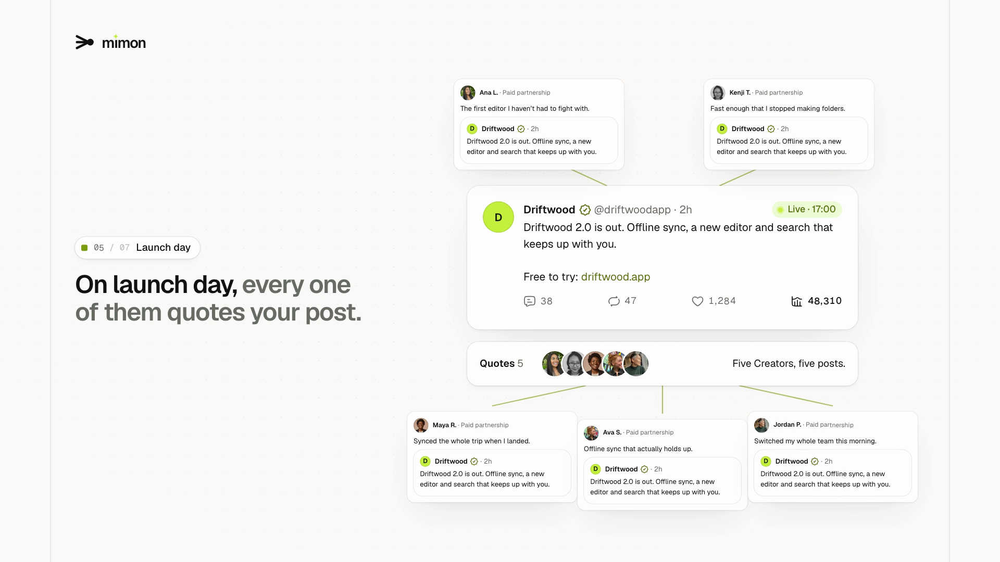
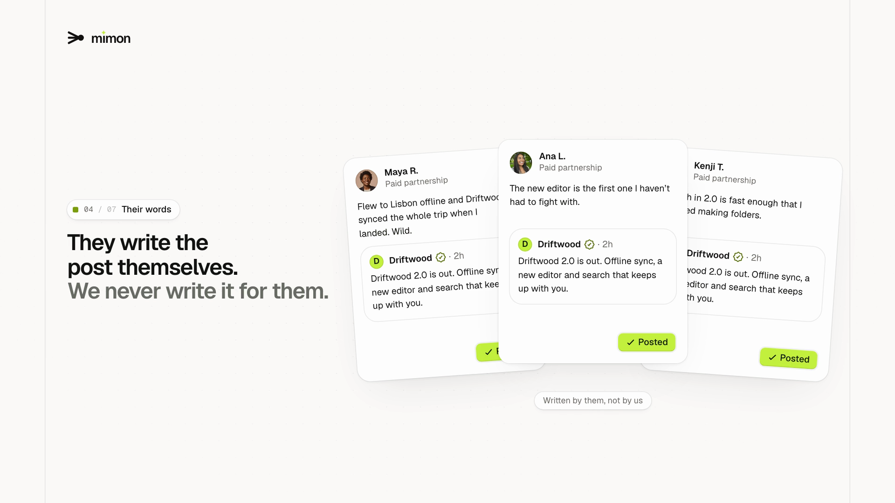
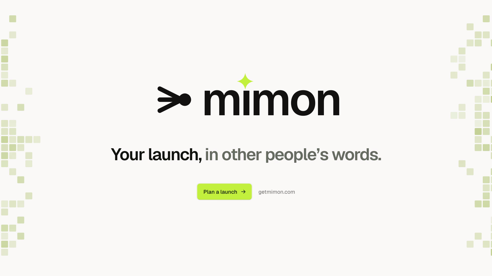

# Codehagen Film Skill

Teach your agent to make product films in code.

There's no After Effects project behind these films. Every frame is code: TypeScript, a browser and a timeline. The skill teaches your coding agent (Claude Code) to build one inside your own app, with your real components, and hand you a first cut of your product in one session.

**[Get the skill → $20 at launch (50% off)](https://buy.polar.sh/polar_cl_JpxRYYKV7tPIuQ91ZsTNE9mC1OgfxDn4mMcXt4dzj55)**

## How it works

1. You ask your agent: "Make a launch film for this product."
2. It asks four questions, sets the film up as a page in your app and checks that rendering works.
3. It writes the story, animates your real components on one clock, and adds sound effects that land on contact.
4. You scrub it live in the browser and give notes with a timestamp. It iterates.
5. When you're happy, one command renders a 1080p60 MP4 with sound effects, voice-over and your music track in sync.

| | |
| --- | --- |
|  |  |

## What's in it

- The process from story to delivery, with every rule and the reason for it
- The engine: springs, morphs, typing, rolling numbers, a pixel motif and a preview player
- Sound effects synthesised with ffmpeg, mixed to −14 LUFS for social video
- A voice-over read in one take and cut by word timings (ElevenLabs, through the Vercel AI SDK or directly)
- Scripts for stills, render, sound, mix and voice

## Works with

A React + Tailwind v4 app (Next.js or Vite) works best. Other stacks work too: the skill builds a separate Vite app next to yours. You need Node 22+ and ffmpeg; voice-over needs a Vercel AI Gateway or ElevenLabs key.

## Questions

christer.hagen@gmail.com or [@codehagen](https://x.com/codehagen) on X.

The skill itself is sold through Polar and isn't in this repo.
